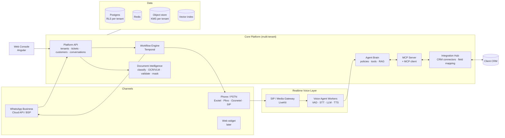

# AI INSURE — AI Voice Agent + CRM Automation Platform (SaaS)

**Master Plan · v0.1 · 3 Nov 2026**
Status: Draft for internal review → client discovery → UI design → build

---

## 0. Summary

We are building a **multi-tenant SaaS platform** that gives an insurance/financial-services business (first client) an AI front office:

1. An **AI Voice Agent** that answers (and later places) phone calls in Indian languages, resolves queries, and takes actions.
2. A **CRM Integration Hub** that reads and writes the client's existing (custom) CRM.
3. **Automatic ticketing**: every request creates or updates a ticket.
4. **KYC Document Intelligence**: Aadhaar/PAN (and later more) received on WhatsApp are recognised, extracted, validated, masked, and written to the right customer record.
5. **Commitment-based follow-ups**: "I'll send it in 2 hours" becomes a scheduled reminder, an escalation ladder, and an automatic ticket update when the document arrives.
6. **MCP layer**: the platform exposes its capabilities as an MCP server, and the agent can call tenant-provided MCP servers. This makes new integrations configuration work, with little or no new code.

**The answer to the GPU question, in short:** we do **not** need GPUs to launch. The recommended Phase 1 design uses managed, streaming speech and LLM APIs. Everything we host ourselves runs on ordinary CPU containers. GPUs become an option, offered as a premium deployment tier, when a client needs full data residency or on-prem hosting, or when call volume is high enough that self-hosting is cheaper. We design the platform **provider-agnostic from day one**, so moving from managed APIs to self-hosted GPU models is a configuration change and not a rewrite. Details in §3.

---

## 1. Goals, non-goals, success metrics

### Goals (v1)
- Inbound voice agent handling the top query types end-to-end, in **English + Hindi + Hinglish** first.
- Full read/write integration with the client's CRM (customers, tickets, KYC fields).
- WhatsApp KYC intake for **Aadhaar and PAN**, with compliant storage.
- Durable follow-up engine (reminders, escalations, auto-closing).
- Web console for the client's team: monitor, review, configure.
- Built multi-tenant from the first line of code, so client #2 is onboarding, not a fork.

### Non-goals (v1)
- Full replacement of the client's CRM.
- Outbound sales campaigns (planned for v2; see §11).
- Video KYC (regulated separately).

### Success metrics (agree targets with client in discovery)
| Metric | Indicative target |
|---|---|
| Voice response latency (user stops speaking → agent starts) | p50 < 1.0 s, p95 < 1.6 s |
| Call containment (resolved without human) | 50–70% of in-scope intents |
| Intent / ticket classification accuracy | > 90% |
| KYC field extraction accuracy (after validation) | > 97% field-level, rest routed to human review |
| Document → CRM update time | < 2 min from WhatsApp receipt |
| Pending-document closure rate within SLA | Baseline in pilot, then +30% |
| Wrong-customer document attachment | **0** (hard requirement; see §6.4) |

---

## 2. System architecture



### 2.1 Components

| # | Component | Responsibility | Runs on |
|---|---|---|---|
| 1 | **Telephony / SIP gateway** | Phone numbers, SIP trunk, media streaming, call recording, transfer to human | Provider + LiveKit SIP |
| 2 | **Voice Agent Workers** | Real-time pipeline: VAD → streaming STT → turn detection → LLM → streaming TTS; barge-in handling | Node.js CPU pods; GPU model servers only in self-host modes |
| 3 | **Agent Brain** | Persona, guardrails, intent handling, tool calling, grounded answers (RAG over tenant KB), caller authentication | CPU |
| 4 | **Platform API** | Tenants, users, RBAC, customers (shadow copy), tickets, conversations, documents, audit | CPU |
| 5 | **Workflow Engine (Temporal)** | Durable timers and long-running flows: follow-ups, KYC pipeline, SLA timers, retries, CRM sync | CPU |
| 6 | **Document Intelligence** | Classify doc type → extract fields → validate (checksums, formats) → match to customer → mask → store | CPU (API mode) / GPU (self-host OCR/VLM) |
| 7 | **Integration Hub** | Pluggable CRM connectors, field mapping, webhooks in/out, idempotent sync, outbox pattern | CPU |
| 8 | **MCP Server + Client** | Exposes platform tools over MCP; consumes tenant MCP servers | CPU |
| 9 | **Web Console** | Ops, review queues, agent studio, integrations, analytics | Static + SSR |
| 10 | **Observability & Evals** | Traces per call turn, latency breakdowns, transcript QA, regression test suite of simulated calls | CPU |

### 2.2 Key design principles
- **Provider-agnostic interfaces** for STT, TTS, LLM, OCR, telephony, WhatsApp BSP, CRM. Each tenant picks providers in config.
- **The agent never invents facts.** Policy, premium, claim, and ticket data come only from tool calls (CRM/MCP) or the tenant knowledge base. If nothing is found, the agent says so and offers a human.
- **Authenticate before disclosing.** Caller ID match plus a second factor (DOB / policy number / OTP on WhatsApp) before any personal data is spoken.
- **Everything is an event.** Calls, messages, documents, and ticket changes are events. This gives a full timeline per customer and an audit trail.
- **Durable by default.** Anything that waits (a 2-hour reminder, a CRM retry) lives in Temporal, not in cron or memory.
- **Tenant isolation everywhere:** Postgres row-level security, per-tenant KMS keys, per-tenant object-store prefixes, tenant-scoped MCP tokens.

---

## 3. The voice agent and the GPU decision

### 3.1 How a voice turn works
```
Caller audio ─▶ VAD/endpointing ─▶ Streaming STT ─▶ Turn detector ─▶ LLM (streaming, tool calls)
                                                                         │
Caller ◀── audio ◀── Streaming TTS ◀── first sentence chunk ◀────────────┘
```
**Latency budget, target ~1 s:** endpointing 200–300 ms · STT final 100–250 ms · LLM first token 250–450 ms · TTS first audio 100–200 ms · network/telephony 100–150 ms.
Techniques: stream everything; speak the first clause while the rest generates; filler/acknowledgement audio during slow tool calls ("Let me check your policy…"); pre-fetch the customer record from caller ID **before** the first greeting; keep hot-path tools in-process (no extra network hops).

### 3.2 Three deployment modes

| | **Mode A: Managed APIs** (recommended for launch) | **Mode B: Hybrid** | **Mode C: Fully self-hosted / BYOC** |
|---|---|---|---|
| STT | Managed streaming (e.g. Sarvam, Deepgram, Google, Azure; chosen by bake-off for Hindi/Hinglish) | Self-hosted Indic STT on GPU | Self-hosted |
| LLM | Claude via API or a cloud marketplace (Haiku-class for live turns, Sonnet-class for complex reasoning and document checks) | Managed | Self-hosted open-weight model |
| TTS | Managed streaming (Indian voices) | Managed or self-hosted | Self-hosted |
| GPU needed? | **No** | Yes, small (STT) | **Yes**, larger |
| Time to market | Fastest | Medium | Slowest |
| Data residency | Depends on vendor regions; contract DPAs | Audio stays in-house | Full control (client VPC / on-prem) |
| Best for | MVP, SMB tenants, pilots | Mid-size, audio-sensitive tenants | Large insurers/banks with strict localisation |

**Recommendation:** launch on **Mode A**, built behind provider interfaces. Run a GPU benchmark in Phase 0 so we can quote Mode C with real numbers for enterprise tenants.

### 3.3 If we self-host (Mode B/C): indicative GPU sizing
These numbers are starting points for the Phase 0 benchmark, not commitments:
- **STT** (Whisper-large-v3-turbo / faster-whisper, AI4Bharat IndicConformer-class models): 1× NVIDIA **L4 (24 GB)** typically serves tens of concurrent streams.
- **TTS** (Indic Parler-TTS / XTTS-class): 1× **L4** for a few dozen concurrent streams; TTS is usually the tighter bottleneck.
- **LLM** (open-weight, 8B–30B, with vLLM): 1× **L40S / A100 / H100**, depending on model size and concurrency. Tool-calling quality must be evaluated, not assumed.
- Autoscale on concurrent-call count. Keep a warm minimum, because cold-starting GPU pods is too slow for live calls.

**Rule of thumb:** self-hosting pays off only at sustained high volume or under a hard data-residency requirement. Below that, managed APIs are cheaper and better.

### 3.4 Indicative cost per call-minute (Mode A)
Telephony + STT + LLM + TTS + infra is typically **a few rupees per minute**. TTS and telephony usually dominate. *Vendor prices change often. In Phase 0 we will build a cost model from live quotes and use it to set SaaS pricing (for example a per-minute rate plus a platform fee).*

### 3.5 Telephony (India-specific)
- Indian PSTN numbers must come from a licensed provider: **Exotel, Plivo, Ozonetel, Knowlarity, Tata Tele**, or the client's existing SIP trunk / call-center PBX.
- Connect through **SIP** or the provider's **WebSocket media stream** into LiveKit.
- Needed: call recording with a consent announcement, warm transfer to a human queue with an AI summary, DTMF fallback, and **TRAI/TCCCPR** compliance for outbound calls (DND scrubbing, calling hours, registered headers).

### 3.6 Voice framework
**LiveKit Agents for Node.js** (`@livekit/agents`, open source; SIP support, turn detection, scales horizontally). It lets us swap STT/LLM/TTS providers per tenant through plugins or our own adapters.

---

## 4. CRM integration (custom CRM)

Because the client's CRM is custom, we build an **Integration Hub** with a connector contract. The first connector is theirs; later connectors (Salesforce, Zoho, LeadSquared, Freshdesk, HubSpot, Dynamics) plug into the same contract.

### 4.1 Connector contract (capabilities)
`find_customer(phone|email|policy_no|pan)` · `get_customer(id)` · `update_customer_fields(id, fields)` · `attach_document(id, file, meta)` · `create_ticket(...)` · `update_ticket(id, ...)` · `add_note(...)` · `list_open_tickets(customer_id)` · `subscribe_webhooks(...)`

### 4.2 Integration options for the client CRM (decided in discovery)
1. **REST/GraphQL API** (preferred).
2. **Webhooks**, both ways, for near-real-time sync.
3. **Their own MCP server**, if they build or have one. We connect to it as an MCP client.
4. **Direct DB access** through a read replica plus a write API (last resort).
5. **No API at all:** we help them build a thin API, or use RPA as a stop-gap. This is a project risk and must be found in week 1.

### 4.3 Sync design
- **Field mapping UI**: map our canonical fields (e.g. `kyc.pan.number_masked`) to their CRM fields, without code.
- **Outbox pattern + idempotency keys**, so no duplicate tickets after retries.
- **Source of truth:** the CRM stays master for customer data. We keep a cached shadow copy for low latency and for history.
- **Conflict rule:** latest write wins for simple fields. Human review for KYC identity fields.

---

## 5. Automated ticket management

### 5.1 Create-or-update logic
```
Interaction ends (call/WhatsApp) →
  extract: intent, sub-intent, entities, sentiment, resolution status, commitments
  → find open tickets for same customer + same category within N days
      match found  → append interaction, update status/priority/fields
      no match     → create ticket
  → sync to CRM (connector) → notify assignee if human action needed
```

### 5.2 Ticket model (canonical)
`id, tenant_id, crm_ticket_id, customer_id, category, sub_category, priority, status, channel_origin, summary, timeline[], linked_documents[], pending_items[], sla_due_at, assignee, ai_confidence`

### 5.3 Statuses
`New → In Progress → Awaiting Customer (docs pending) → Awaiting Internal → Resolved → Closed`, plus `Escalated`. The **Awaiting Customer** status is driven automatically by the follow-up engine.

### 5.4 Post-call output
Summary, disposition, extracted fields, and next actions are written to the ticket and the CRM within seconds of hang-up.

---

## 6. KYC document intelligence (WhatsApp)

### 6.1 Pipeline
```
WhatsApp media webhook
 → download immediately (Meta media URLs expire) → virus scan → encrypt & store (quarantine)
 → identify sender → match customer (phone → CRM)
 → classify: Aadhaar front / back / e-Aadhaar PDF / PAN / other / not-a-document / unreadable
 → quality check (blur, glare, cropped) → if bad: instant WhatsApp reply asking for a re-upload
 → extract fields (OCR + vision-LLM, structured output)
 → validate (rules below) → cross-match with CRM (name, DOB fuzzy match)
 → MASK Aadhaar (number and image) → store only compliant artefacts
 → confidence ≥ threshold: auto-update CRM + ticket + close follow-up
   otherwise: Human Review Queue
 → confirm to customer on WhatsApp ("Received your PAN, thank you")
```

### 6.2 Fields and validation rules
| Document | Fields | Validation |
|---|---|---|
| **PAN** | PAN no., name, father's name, DOB | Regex `[A-Z]{5}[0-9]{4}[A-Z]`; 4th character = holder type (P = individual); 5th character = surname initial; optional verification through a PAN verification API (Protean/NSDL via a licensed provider) |
| **Aadhaar** | Last 4 digits (stored), name, DOB/YOB, gender, address (if consented) | 12 digits, **Verhoeff checksum**; front and back pairing; secure QR decode where present (signed data, strong tamper check) |
| **e-Aadhaar PDF** | Same | Password-protected: standard pattern is the first 4 letters of the name in capitals + year of birth. Derive it from CRM data, otherwise ask the customer |

### 6.3 Aadhaar compliance (critical)
- Under UIDAI rules we must **not store the full Aadhaar number** unless we are a licensed entity with an Aadhaar Data Vault. Default: **store only the masked number (XXXX-XXXX-1234)** and a **masked image** (first 8 digits blacked out before storage).
- The unmasked original lives only in an encrypted, short-TTL quarantine during processing, then is deleted.
- Capture **explicit consent** for the purpose (DPDP Act 2023), and log the consent.
- Better long-term path: **DigiLocker** integration, where the customer shares verified documents digitally with consent. This means no OCR uncertainty and stronger compliance. Plan it for v2.

### 6.4 Matching to the correct customer (zero-error rule)
- Primary key: WhatsApp number → CRM customer.
- If the number maps to **multiple customers** (family policies), or the **name on the document doesn't fuzzy-match** the CRM record → human review. **Never auto-attach.**
- If the number is unknown → ask for the policy number on WhatsApp, then match.

### 6.5 Human Review Queue
A side-by-side view: masked image | extracted fields | CRM values | confidence. Reviewers can approve, correct, reject, or ask the customer to re-upload. Every correction becomes evaluation data.

### 6.6 Future documents
Driving licence, voter ID, passport, cancelled cheque/bank proof, vehicle RC, medical reports and bills (claims), old policy copies (portability).

---

## 7. Commitments and automated follow-ups

### 7.1 Commitment extraction
During or after a call or chat, the LLM extracts structured commitments:
```json
{ "type": "document_submission", "documents": ["PAN", "AADHAAR"],
  "due_at": "2026-11-03T17:30:00+05:30", "source_phrase": "kal shaam tak bhej dunga",
  "channel": "whatsapp", "confidence": 0.92 }
```
It handles relative and colloquial times ("2 ghante mein", "kal subah", "Monday tak", "after lunch") against the tenant timezone and business calendar.
**The agent confirms out loud:** "Okay, I'll remind you on WhatsApp tomorrow at 10 AM if it isn't received." This confirmation becomes the source of truth.

### 7.2 Follow-up workflow (Temporal, durable)
```
start(commitment)
  wait until due_at  OR  signal(document_received)
  if received → validate → update CRM & ticket → thank customer → done
  else reminder ladder (configurable per tenant):
     R1  WhatsApp template reminder (with upload instructions)
     R2  +X hours: WhatsApp reminder + call-back offer
     R3  +Y hours: AI outbound call
     R4  create a task for a human agent, ticket → Escalated
  respect quiet hours, holidays, opt-outs, and per-customer frequency caps
```

### 7.3 WhatsApp rules we must design for
- **24-hour customer-service window:** reminders sent after 24 hours of customer silence **must use pre-approved message templates** (Utility category). Template creation and approval need to start early in the project.
- Template variables: name, document list, due date, upload link/instructions.
- Opt-out handling ("STOP") and per-category frequency limits.

---

## 8. Cloud and MCP integration

### 8.1 Cloud
- **Primary region in India**: AWS ap-south-1 (Mumbai), with ap-south-2 (Hyderabad) for DR. Azure Central India or GCP Mumbai are fine equivalents if the client prefers.
- **Kubernetes (EKS)** for services and voice workers, **RDS Postgres**, **ElastiCache Redis**, **S3 + KMS** (per-tenant keys), **Temporal** (Cloud or self-hosted), **OpenSearch/pgvector** for RAG.
- Infrastructure as code (**Terraform**), GitOps deploys, separate dev / staging / prod accounts.
- SaaS deployment tiers: **Shared multi-tenant** (default) → **Dedicated single-tenant VPC** → **BYOC/on-prem** (Mode C with GPUs).

### 8.2 MCP: both directions
**(a) Platform as MCP server.** We expose our capabilities as MCP tools:
`customer.search`, `customer.get_360`, `ticket.create`, `ticket.update`, `ticket.list_open`, `kyc.get_status`, `kyc.request_document`, `followup.schedule`, `followup.cancel`, `conversation.get_transcript`, `kb.search`
- Our **own voice agent** uses these tools, so there is one tool layer for voice, WhatsApp, and future channels.
- The client's internal staff can connect **Claude or other MCP-capable assistants** to the platform ("show all customers with pending PAN older than 3 days").
- Transport: **Streamable HTTP**, **OAuth 2.1**, tenant-scoped tokens, per-tool RBAC, full audit log of every tool call.

**(b) Platform as MCP client.** A tenant can register their own MCP servers (for example their CRM's MCP, a policy admin system, or a claims system). The agent then gets those tools after an admin allow-lists them. This is how we integrate new systems without custom connector code.

**Latency note:** for live voice, the most frequent tools (customer lookup, open tickets) are cached or called in-process. MCP is used for long-tail and external tools.

---

## 9. Security, privacy, and compliance

| Area | Measures |
|---|---|
| **DPDP Act 2023** | Consent capture and logging, purpose limitation, data minimisation, right to erasure workflow, breach process, DPA with each tenant |
| **Aadhaar / UIDAI** | Masked storage only, no full numbers in logs/transcripts/LLM prompts where avoidable, quarantine TTL |
| **IRDAI (insurance tenants)** | India data localisation, record retention per regulation, outsourcing guidelines; confirm with client compliance |
| **TRAI / TCCCPR** | DND scrubbing, calling windows, consent for outbound |
| **Call recording** | Opening disclosure, retention policy per tenant, encrypted storage |
| **PII handling** | Redaction in transcripts and logs, field-level encryption for identity fields, KMS per tenant |
| **Access** | SSO (SAML/OIDC), RBAC, least privilege, IP allow-lists for enterprise, audit log of every view of a KYC document |
| **AI safety** | Prompt-injection defence (documents and messages are data, not instructions), tool allow-lists per intent, no-disclosure-before-auth, refusal to give financial advice, human handoff |
| **Assurance** | VAPT before go-live, then ISO 27001 / SOC 2 roadmap for SaaS sales |

---

## 10. Technology stack (decided: Node.js + Angular only)

**Decision (4 Nov 2026):** the whole platform is **TypeScript on Node.js**, and the console is **Angular (latest)**. We run no Python services. Every component in this plan has a mature Node option, so we lose no capability.

| Layer | Choice | Why |
|---|---|---|
| Language / runtime | TypeScript 6 on Node.js 22 LTS | One language from frontend to backend. TypeScript is pinned to 6.0 because Angular 22 and NestJS 12 require it |
| Monorepo | npm workspaces | Already installed, no extra tooling |
| Platform API | NestJS 12 | Modules, dependency injection and decorators, structured like Angular. Familiar to the frontend team |
| Voice orchestration | LiveKit Agents for Node.js (`@livekit/agents`) | SIP, turn detection, streaming STT → LLM → TTS |
| Workflows | Temporal TypeScript SDK | Durable timers, retries, signals. Ideal for follow-ups |
| MCP | Official MCP TypeScript SDK (`@modelcontextprotocol/sdk`) | Reference implementation; Streamable HTTP + OAuth |
| LLM | Claude via `@anthropic-ai/sdk` (Haiku 5.5 for live turns; Sonnet 5.5 for documents, summaries, complex reasoning), behind an interface | Tool-use quality, vision for documents |
| Validation / schemas | Zod | Shared runtime-checked types across API, workflows and MCP tools |
| DB | PostgreSQL (RLS) + pgvector | Multi-tenant isolation, one DB to operate |
| Cache / queues | Redis | Sessions, rate limits |
| Object storage | S3 + KMS (MinIO locally) | Recordings, documents |
| STT / TTS | Chosen by Phase 0 bake-off (Hindi/Hinglish accuracy and latency), called over streaming APIs | Language quality decides this, not brand |
| Frontend | Angular 22 (standalone components, signals) | Team standard |
| Tests | Vitest | Fast, TypeScript-native |
| Infra | AWS India, EKS, Terraform, GitHub Actions | Standard, auditable |
| Observability | OpenTelemetry, Grafana/Prometheus, Sentry, LLM tracing | Per-turn latency and quality tracing |

**Where Python could appear, and why we don't need it:** only in deployment Modes B and C (§3.2), where self-hosted speech and LLM models run on GPUs. Those run as **ready-made model-server containers** (for example vLLM or Triton) that our Node services call over HTTP. We deploy them; we don't write or maintain Python code. Mode A (launch) has no Python anywhere.

### Monorepo layout
```
ai-insure/
├── apps/
│   └── console/              # Angular web console
├── services/
│   ├── api/                  # NestJS platform API (tenants, tickets, customers, documents, WhatsApp webhooks)
│   ├── voice-agent/          # LiveKit Agents (Node) workers
│   ├── workflows/            # Temporal workers (follow-ups, KYC pipeline, CRM sync)
│   └── mcp-server/           # MCP server (Streamable HTTP + OAuth)
├── packages/
│   ├── shared/               # Zod schemas, types, constants
│   ├── connectors/           # CRM connector contract + adapters
│   ├── providers/            # STT/TTS/LLM/vision adapter interfaces
│   └── doc-intel/            # KYC validation, masking, matching (used by workflows and API)
├── infra/                    # Terraform, Helm
├── evals/                    # Simulated calls, doc test sets, regression suites
└── docs/
```
The WhatsApp gateway is a module inside the API to begin with, so there is one less service to run. It can be split out later if message volume needs it.

---

## 11. Beyond the current scope (recommended roadmap additions)

High value, low extra effort, because they reuse the same core:
1. **WhatsApp conversational agent.** The same brain over text: queries, status checks, and document requests in one thread.
2. **Outbound AI calls.** Renewal reminders, premium-due nudges, KYC chase calls, NPS/CSAT surveys. TRAI-compliant.
3. **Human handoff and agent assist.** Warm transfer with a live summary. Real-time suggestions for human agents.
4. **100% call QA and analytics.** Every call scored for compliance phrases, sentiment, resolution, and mis-selling risk. Dashboards for containment, AHT, CSAT, and document turnaround.
5. **Knowledge base (RAG)** over policy wordings, FAQs, and SOPs per tenant. Answers include citations visible in the console.
6. **DigiLocker + verification APIs.** Verified Aadhaar/PAN pull, PAN–name match, face match (selfie vs document photo), tamper/forgery detection.
7. **Insurance-specific flows.** Claims first-notice-of-loss (FNOL) intake over voice, policy status, UPI payment links for premiums, renewal quotes, endorsements.
8. **Caller authentication.** OTP on WhatsApp, voice biometrics (later).
9. **No-code Agent Studio.** Tenants configure persona, voice, languages, intents, flows, and guardrails, and can test in the browser.
10. **Evaluation harness.** Simulated callers in many accents and languages, with regression tests before every prompt or model change. This is critical for SaaS quality.
11. **SaaS commercial layer.** Self-serve onboarding, plans, usage metering (minutes, documents, messages), Razorpay/Stripe billing, white-labelling for partners and brokers.
12. **More languages**: Tamil, Telugu, Marathi, Bengali, Gujarati, Kannada, Malayalam.

---

## 12. UI plan (next step after this plan is approved)

Web console screens (wireframes, then a clickable prototype):

| # | Screen | Purpose |
|---|---|---|
| 1 | **Login / SSO / tenant switcher** | Access |
| 2 | **Command Center dashboard** | Live calls, today's tickets, pending documents, SLA breaches, containment rate |
| 3 | **Live Calls** | Real-time transcript, sentiment, listen-in, "take over" button |
| 4 | **Conversations** | Call/WhatsApp history, recording player, transcript, AI summary, extracted data |
| 5 | **Tickets** | List and Kanban views; detail page with a unified timeline (voice + WhatsApp + CRM) |
| 6 | **Customer 360** | CRM data, KYC status badges, documents (masked), tickets, follow-ups, consent |
| 7 | **KYC Review Queue** | Masked image ↔ extracted fields ↔ CRM values, confidence, approve/correct/reject |
| 8 | **Follow-ups** | Scheduled / due / overdue, reminder-ladder progress, manual nudge |
| 9 | **Agent Studio** | Persona, prompts, voice and language, intents, tools, guardrails, KB, browser test call |
| 10 | **Integrations** | CRM connector setup and field mapping, WhatsApp number, telephony, MCP servers |
| 11 | **Templates** | WhatsApp templates (with approval status), call scripts |
| 12 | **Analytics** | Volume, containment, latency, document TAT, CSAT, cost per conversation |
| 13 | **Settings** | Users and roles, compliance (retention, masking), billing and usage, audit log, API keys |

Design direction: clean enterprise look, dense but calm data tables, dark/light themes, status colours used consistently (Pending / Received / Verified / Rejected), mobile-friendly for supervisors.

---

## 13. Delivery phases (indicative)

| Phase | Duration | Output |
|---|---|---|
| **0. Discovery and foundations** | 2–3 weeks | Client CRM API audit, sample calls and documents, top-20 intents, language mix, volumes; **STT/TTS bake-off** on real Hindi/Hinglish audio; GPU benchmark for Mode C; compliance sign-off; WhatsApp templates submitted; final architecture |
| **1. UX/UI design** | 2–3 weeks (overlaps Phase 0) | Wireframes → high-fidelity → clickable prototype of the console; call-flow designs |
| **2. MVP build** | 8–10 weeks | Inbound voice agent (EN/HI/Hinglish), client CRM connector, ticket create/update, WhatsApp Aadhaar/PAN pipeline with review queue, follow-up engine, console core screens, MCP server v1, observability |
| **3. Pilot** | 4 weeks | Shadow mode (AI listens, humans act) → 10% of traffic → ramp; weekly accuracy and latency reviews |
| **4. SaaS hardening and v2** | Ongoing | Multi-tenant onboarding, billing, more connectors, outbound calls, WhatsApp agent, analytics, DigiLocker |

Indicative core team: 1 tech lead/architect, 2 backend/AI engineers, 1 voice/real-time engineer, 1 frontend engineer, 1 designer (Phases 1–2), 1 QA, part-time DevOps, part-time compliance advisor.

---

## 14. Key risks and mitigations

| Risk | Mitigation |
|---|---|
| Hinglish/regional STT accuracy on noisy phone lines | Bake-off on the client's real recordings; custom vocabulary (policy terms, product names); confirm critical values back to the caller |
| Latency over PSTN | Streaming everywhere, India-region providers, pre-fetching, filler audio |
| Custom CRM has a weak or no API | Find out in week 1; build a thin API with their team; MCP as the integration path |
| Aadhaar compliance misstep | Masked-only storage by design, legal review in Phase 0 |
| WhatsApp template delays | Submit templates in Phase 0 |
| LLM gives a wrong policy answer | Grounded answers only, tool-verified data, eval suite, human handoff |
| Wrong document attached to the wrong customer | Multi-signal matching + human review on any doubt |
| Cost per minute erodes SaaS margin | Cost model in Phase 0; provider routing; Mode B/C at scale |

---

## 15. Open questions for the client (discovery checklist)

**Business**
1. Top call reasons today and monthly call volume? Peak concurrent calls?
2. Inbound only, or outbound too in v1? Working hours vs 24×7?
3. Languages and their share (English / Hindi / Hinglish / regional)?
4. Which actions may the AI take without a human (e.g. update address? cancel policy? never?)

**CRM**
5. CRM tech stack, API availability and docs, sandbox environment, webhook support?
6. Ticket structure today: categories, statuses, SLAs, assignment rules?
7. Where are KYC fields stored? Do they store Aadhaar today, and how?

**Channels**
8. Existing telephony / call-center system and provider? Existing phone numbers to keep?
9. WhatsApp Business API already set up? Which BSP? Verified business?

**Compliance and infra**
10. Regulator (IRDAI / RBI / SEBI)? Data-localisation requirements? Cloud preference?
11. Call recording and retention policy? Consent language?
12. Need for on-prem/private deployment (decides the GPU question for them)?

**Data for building**
13. Sample anonymised call recordings (50–200) and sample documents (with consent / masked) for evaluation?

---

## 16. Immediate next steps
1. Review this plan internally. Mark changes and decisions.
2. Send §15 to the client and schedule discovery.
3. Start the UI design (§12): wireframes for Command Center, Ticket detail, Customer 360, KYC Review Queue, and Agent Studio first.
4. Set up the repo skeleton (§10) and run the STT/TTS bake-off harness in parallel.
