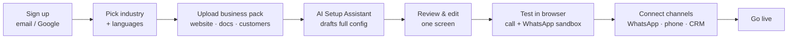

# AI INSURE — Self-Serve SaaS Plan

**v0.1 · 7 Nov 2026** · Builds on [PLAN.md](PLAN.md) (architecture, KYC, follow-ups, compliance). Where the two differ, this document is newer.
Status: for review → lock the decisions in §10 → start coding Milestone M0.

---

## 1. The goal in one sentence

A business signs up, uploads what it already has (FAQs, policy documents, a customer list), connects WhatsApp in a few clicks, and is talking to its own AI agent **in under 30 minutes**, with no call to us.

The platform does the configuration work. The customer only reviews and approves it.

### What "minimum things" means for the customer

| They do | We do automatically |
|---|---|
| Sign up with email or Google | Create their workspace, sandbox, trial credit, default roles |
| Pick their industry (Insurance, Lending/NBFC, Broking, …) | Load an **industry pack**: intents, ticket categories, SLAs, KYC document types, WhatsApp templates, compliance defaults |
| Enter their website and upload documents | Read everything, build the knowledge base, draft the agent's persona, greeting, FAQs and ticket categories |
| Upload a customer list (CSV/Excel), **or** connect their CRM | Map the columns with AI and import into the built-in CRM, or set up the connector |
| Click "Connect WhatsApp" | Meta Embedded Signup links their WhatsApp Business number; we submit the template library for approval |
| Make a test call in the browser | Run the real agent against their own data |
| Click **Go live** | Assign a phone number, or give call-forwarding steps for their existing number |

### What can't be instant (and how we handle it)

| Item | Why it takes time | How we keep the customer moving |
|---|---|---|
| **Indian phone number** | Telecom provider must verify the business (KYC: GST/PAN/incorporation) | Customer uploads the documents in the wizard; meanwhile they test via browser calls and WhatsApp. Typical: 1–3 working days |
| **Use an existing number** | No wait | Call forwarding to our number, live the same day |
| **WhatsApp template approval** | Meta review | Templates are submitted automatically at signup. Usually minutes to a day |
| **WhatsApp business verification** | Meta review of the business | Unverified numbers work with lower message limits until verified |
| **Custom CRM with no standard connector** | Needs an API or a mapping | Start on the built-in CRM with CSV import; connect later without losing data |
| **Outbound AI calls** | TRAI/DLT registration and DND rules | Locked until the tenant completes DLT registration; inbound and WhatsApp work from day one |

---

## 2. Onboarding journey



### 2.1 The "business pack" (what we ask them to upload)

All optional except the first. Every step has **Skip for now**.

1. **Company basics**: name, website URL, logo, business hours, holidays, languages, escalation contact.
2. **Knowledge**: policy wordings, product brochures, FAQs, SOPs, claim procedures (PDF, DOCX, XLSX, TXT, or web URLs). We also crawl their website (same domain, page limit).
3. **Customers and policies**: CSV/Excel. We provide a template, but any layout works because AI proposes the column mapping and the user confirms.
4. **Ticket categories and SLAs**: accept the industry pack's list, or upload their current list.
5. **Documents to collect**: Aadhaar and PAN on by default; tick others (driving licence, cancelled cheque, …).

### 2.2 AI Setup Assistant

A background job (Claude Sonnet) reads the business pack and produces a **draft configuration**:

- Agent persona, greeting, tone, languages, voice
- Intents with example phrases, and which ones the AI may resolve vs. hand to a human
- FAQ answers with citations to the uploaded documents
- Ticket categories, priorities and SLAs
- Follow-up rules per document type
- WhatsApp message wording for each template

The user sees it all on **one review screen**, grouped and editable, with "why" notes and source citations. Nothing goes live until they click **Publish**. Every publish is versioned, so they can roll back.

Uploaded documents are treated as **data, never instructions** (prompt-injection defence): the assistant cannot be told by a document to change permissions or tools.

### 2.3 Sandbox and Live modes (like Stripe's test mode)

Every workspace has two modes:

- **Sandbox**: sample customers, browser calls, WhatsApp test numbers, no charges beyond trial credit. Safe to experiment.
- **Live**: real numbers and real customers. Requires a verified email, accepted DPA, and a payment method or prepaid credit.

Config is edited in Sandbox and **promoted** to Live.

---

## 3. Product surfaces

| Surface | Who | Notes |
|---|---|---|
| **Marketing site + signup** | Prospects | Pricing, industry pages, "Start free". Angular SSR for SEO |
| **Onboarding wizard** | New tenant admin | §2. Progress saved; can resume any time |
| **Console** | Tenant team | The screens already designed (Command Center, Live Calls, Tickets, Customer 360, KYC Review, Follow-ups, Agent Studio, Integrations) plus Billing & Usage, Team, Settings |
| **Built-in CRM (lite)** | Tenants without a CRM, or before connecting one | Customers, policies, documents, tickets. Exportable at any time |
| **Developer area** | Tenant developers | API keys, webhooks, MCP server URL and tokens, logs |
| **Platform admin** | Us | Tenants, plans, usage, feature flags, abuse review, support access (time-limited, customer-approved, audited) |

---

## 4. Integrations, self-serve first

Ordered by how little effort they need from the customer:

1. **Built-in CRM + CSV import**: zero integration; works on day one.
2. **One-click connectors** (OAuth): Zoho CRM, Salesforce, HubSpot, LeadSquared, Freshdesk/Freshsales. Pre-built field mappings per industry pack.
3. **Generic REST connector**: customer uploads an **OpenAPI spec** or enters endpoints; AI proposes the mapping to our canonical model; user tests it with a live lookup.
4. **Inbound webhooks / outbound webhooks**: for anything event-driven.
5. **MCP**: tenant registers their MCP server URL; admin allow-lists tools. Our own MCP server lets their staff use Claude or other assistants on their data.
6. **Custom connector** (enterprise, built by us): e.g. the first client's custom CRM.

Channels:
- **WhatsApp**: Meta **Embedded Signup** (we register as a Meta Tech Provider). Customer logs in with Facebook, picks or creates the number, done.
- **Telephony**: we hold a master account with an Indian CPaaS provider (Exotel/Plivo/Ozonetel, picked in the Phase 0 bake-off) and create a **sub-account per tenant** through their API. Options in the wizard: *get a new number* (KYC upload) or *forward my existing number*. Enterprise: bring their own SIP trunk.
- **Browser / website widget**: LiveKit WebRTC; works with no phone number at all.

---

## 5. Plans, metering and billing

Structure only. Prices come from the Phase 0 cost model.

| | **Trial** | **Starter** | **Growth** | **Enterprise** |
|---|---|---|---|---|
| Channels | Browser + WhatsApp sandbox | 1 number, 1 WhatsApp | Multiple | Unlimited, own SIP |
| Included usage | Small credit | Monthly minutes, docs, messages | More | Committed volume |
| CRM | Built-in | Built-in + 1 connector | All connectors | Custom connector |
| Users | 2 | 5 | 25 | Unlimited + SSO |
| Deployment | Shared | Shared | Shared | Dedicated / on-prem (GPU) |

- **Metered units**: AI call minutes, outbound minutes, documents processed, WhatsApp conversations, PAN verifications (pass-through).
- **Prepaid wallet** (common in India) plus monthly subscription. Low-balance alerts and auto top-up. Hard stop on zero balance for Live outbound; inbound keeps working for a grace period so their customers are never cut off mid-day.
- **Razorpay** for India (UPI, cards, net banking, e-mandate), with **GST invoices**. Stripe later for international.
- Usage is recorded as events, aggregated hourly, and shown live on the Billing page.

---

## 6. Architecture changes for self-serve SaaS

The core in PLAN.md §2 stays. Changes below keep **everything we write in Node.js/TypeScript** and keep the number of services we run to a minimum.

### 6.1 Services we run

| Service | Tech | Purpose |
|---|---|---|
| `api` | NestJS | REST API, auth, tenancy, webhooks (WhatsApp, telephony, billing), onboarding |
| `worker` | Node + BullMQ | Background jobs: document ingestion, AI setup, KYC pipeline, follow-up reminders, CRM sync, usage aggregation |
| `voice-agent` | LiveKit Agents (Node) | Real-time calls |
| `mcp-server` | MCP TypeScript SDK | Streamable HTTP + OAuth |
| `web` | Angular 22 (SSR) | Marketing site, signup, onboarding, console |

### 6.2 Infrastructure we depend on

| Need | Choice | Why |
|---|---|---|
| Database | PostgreSQL 17 + pgvector (AWS RDS, Mumbai) | One database for data, vectors and RLS |
| Cache / jobs | Redis (ElastiCache) | Sessions, rate limits, BullMQ |
| Files | S3 + KMS (MinIO locally) | Documents, recordings |
| Real-time media | **LiveKit Cloud** to start | No media servers to operate; self-host later if cost or residency needs it |
| AI | Claude API (Haiku 5.5 live, Sonnet 5.5 for setup/documents) | Behind a provider interface |
| STT / TTS | Managed streaming, picked by bake-off | Behind a provider interface |

### 6.3 Proposed change: BullMQ instead of Temporal

PLAN.md chose Temporal for follow-ups. Temporal needs its own server cluster (or a paid Temporal Cloud account). For a lean SaaS start, **BullMQ on the Redis we already run** covers delayed reminders, retries and the reminder ladder, with follow-up state stored in Postgres so nothing is lost if a worker restarts. We keep the follow-up engine behind an interface so we can move to Temporal later if flows become much more complex. **Needs your OK (§10).**

### 6.4 Multi-tenancy model

- **Tenant = organisation.** Users belong to one or more organisations with a role (Owner, Admin, Supervisor, Agent, Reviewer, Developer, Read-only).
- Every table carries `tenant_id` and `mode` (`sandbox` | `live`). **Postgres row-level security** is forced on every tenant table; the tenant comes from the authenticated session, never from the request body.
- Per-tenant **KMS data keys** for documents and identity fields.
- Per-tenant limits (rate, concurrency, storage) from the plan, enforced in the API and the voice agent.
- Enterprise tenants can be moved to a **dedicated database or VPC** without code changes (connection routed by tenant).

### 6.5 Trust and abuse controls (self-serve risks)

- Email verification and disposable-email blocking; phone verification before Live.
- Outbound calling locked until business KYC and DLT registration are complete.
- Knowledge uploads scanned (malware) and size/page limited.
- Spend caps per day; anomaly alerts (sudden call spikes, many failed WhatsApp sends).
- Aadhaar masking **always on and not configurable**; data region always India.
- Click-through **Data Processing Agreement** at go-live (tenant is the data fiduciary, we are the processor under DPDP).

---

## 7. Data model, first cut

```
organizations(id, name, industry, plan, region, status, created_at)
users(id, email, name, mfa_enabled, …)                  -- via auth library
memberships(user_id, org_id, role)
workspaces_config(org_id, mode, version, json, published_at, published_by)
knowledge_sources(id, org_id, mode, type, uri, status, pages, error)
knowledge_chunks(id, org_id, source_id, text, embedding vector, meta)
customers(id, org_id, mode, external_id, name, phone_e164, email, dob_enc, pan_enc, kyc_status, …)
policies(id, org_id, customer_id, number, product, status, renewal_date, premium, …)
conversations(id, org_id, mode, channel, customer_id, started_at, ended_at, summary, sentiment)
messages / call_turns(conversation_id, role, text, at, …)
tickets(id, org_id, mode, customer_id, category, priority, status, sla_due_at, assignee_id, crm_ticket_id, …)
ticket_events(ticket_id, type, payload, at, actor)
documents(id, org_id, customer_id, type, status, masked_key, fields_enc, confidence, reviewed_by)
commitments(id, org_id, customer_id, ticket_id, items, due_at, status, source_phrase)
followup_steps(commitment_id, step, channel, scheduled_at, sent_at, result)
integrations(id, org_id, type, status, config_enc, field_map)
phone_numbers(id, org_id, provider, e164, status, kyc_status)
usage_events(id, org_id, mode, unit, qty, at, ref)
wallet_ledger(id, org_id, amount, reason, ref, at)
audit_log(id, org_id, actor, action, target, at, ip, hash_prev)  -- tamper-evident chain
```

---

## 8. Build plan (milestones)

Each milestone ends with something we can demo. Durations assume the core team in PLAN.md §13.

| # | Milestone | Done when | Est. |
|---|---|---|---|
| **M0** | **Foundations** | Monorepo, NestJS API, Angular shell, auth (signup, login, Google, MFA), organisations + roles, Postgres RLS with tests, migrations, audit log, local Docker Compose, CI with security scans | 2 wks |
| **M1** | **Onboarding + knowledge** | Signup → industry pack → upload docs/URL → ingestion into pgvector → CSV customer import with AI column mapping → built-in CRM screens | 2–3 wks |
| **M2** | **AI Setup Assistant + browser test call** | Draft config generated from the business pack; review/publish screen; agent answers a browser call using the tenant's KB and customer data; tickets created from calls | 3 wks |
| **M3** | **WhatsApp + KYC** | Embedded Signup; inbound messages; Aadhaar/PAN pipeline with masking and review queue; template library auto-submitted | 3 wks |
| **M4** | **Follow-ups** | Commitment extraction from calls/chats; reminder ladder; auto-close on receipt; follow-ups screen | 2 wks |
| **M5** | **Phone numbers + go-live** | CPaaS sub-accounts; number purchase with KYC upload; call forwarding option; Sandbox → Live promotion; human transfer | 2–3 wks |
| **M6** | **Billing** | Plans, Razorpay subscription + wallet, usage metering, GST invoices, limits and alerts | 2 wks |
| **M7** | **Connectors + MCP** | Zoho/HubSpot/Salesforce/LeadSquared/Freshdesk; generic REST from OpenAPI; webhooks; MCP server + tenant MCP servers | 3–4 wks |
| **M8** | **Platform admin + hardening** | Admin console, feature flags, evals suite, observability dashboards, DPDP export/delete, load test, VAPT | 2–3 wks |

M3 and M5 depend on outside approvals (Meta Tech Provider, CPaaS partner account). **Apply for both during M0** so they're ready when we need them.

The first client (custom CRM) is onboarded as **tenant #1 on the Enterprise plan** through the same product, with a custom connector built in M7. No fork.

---

## 9. Quality bar for "upload and it's done"

| Measure | Target |
|---|---|
| Signup → first browser test call | < 30 minutes, no help from us |
| Wizard completion rate | Tracked from day one; every drop-off step reviewed weekly |
| AI-drafted config accepted without edits | > 70% of items |
| CSV column mapping correct first time | > 90% of columns |
| Support tickets per new tenant in first week | < 1 |

---

## 10. Decisions needed before coding M0

Recommendations first. These were open from the earlier review.

| # | Decision | Recommendation | Alternatives |
|---|---|---|---|
| 1 | **Database access (ORM)** | **Drizzle ORM**: SQL-first, typed, light, works cleanly with Postgres RLS and pgvector | Prisma (heavier runtime, RLS is awkward), TypeORM (older patterns) |
| 2 | **Authentication** | **Better Auth** (TypeScript library, runs inside our API, data in our Postgres): email/password, Google, magic link, MFA, organisations, SAML SSO later. No extra service | Keycloak (separate Java server), Auth0/Clerk (paid external service, data outside India) |
| 3 | **Background jobs** | **BullMQ on Redis** (§6.3) | Temporal (extra cluster), pg-boss (Postgres-only) |
| 4 | **Monorepo tooling** | **npm workspaces + Nx** for build caching and affected-only CI | npm workspaces alone (simpler, slower CI as it grows) |
| 5 | **UI component library** | **Angular Material + CDK** with our own design tokens (matches the wireframes) | PrimeNG (richer tables, heavier, less consistent) |
| 6 | **API style** | REST + OpenAPI generated from NestJS, typed client generated for Angular | GraphQL (more moving parts for little gain here) |
| 7 | **Hosting (our SaaS)** | AWS Mumbai: **ECS Fargate** to start, Terraform, move to EKS when voice workers need it | EKS from day one (more ops work early) |
| 8 | **Real-time media** | **LiveKit Cloud** to start | Self-hosted LiveKit (Go server we'd operate) |
| 9 | **Product name and domain** | Needed for signup pages, emails and the Meta Tech Provider application | — |

### Accounts to start applying for now (long lead times)
- Meta Business verification + **Tech Provider** for WhatsApp Embedded Signup
- CPaaS partner/reseller account (Exotel / Plivo / Ozonetel)
- Razorpay business account
- Anthropic API org with India-region data handling reviewed
- AWS organisation (dev / staging / prod accounts)

---

## 11. What we start coding first (M0, week 1)

1. Repo skeleton: `apps/web` (Angular), `services/api` (NestJS), `services/worker`, `packages/shared` (Zod schemas), `packages/db` (Drizzle schema + migrations), Docker Compose (Postgres + pgvector, Redis, MinIO).
2. Auth and organisations: signup, login, Google, email verification, org creation, invites, roles.
3. Tenancy guardrails: RLS policies, request-scoped tenant context, tests that prove tenant A can never read tenant B.
4. Audit log and structured logging with PII redaction.
5. CI: lint, type-check, tests, CodeQL, secret scanning, dependency and container scanning.
6. Angular shell: login, signup, empty onboarding wizard, console layout from the wireframes.
